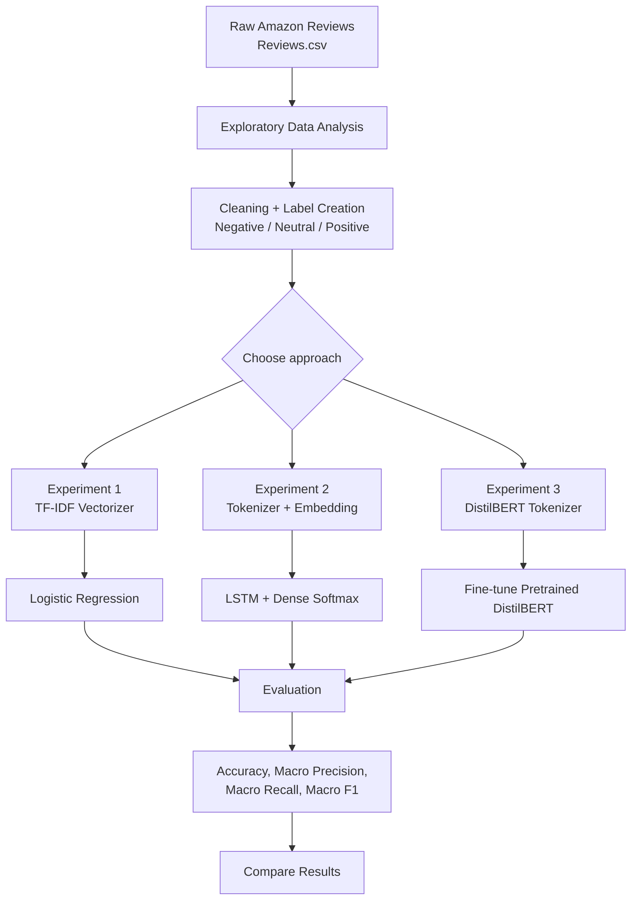
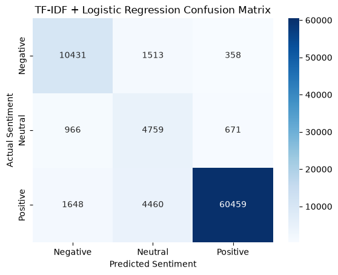
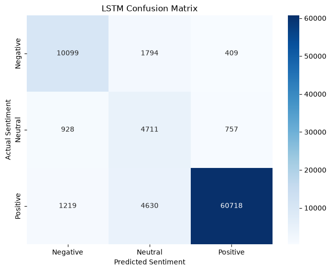
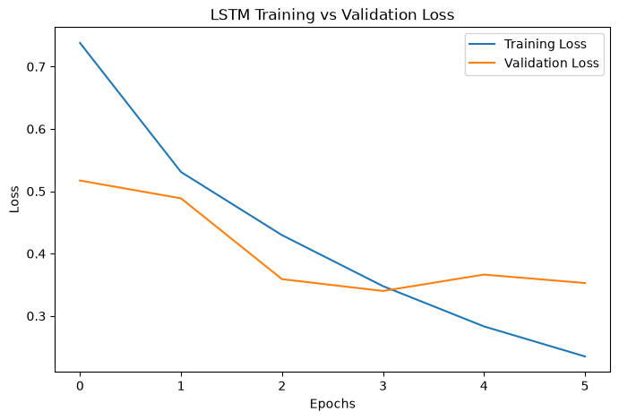
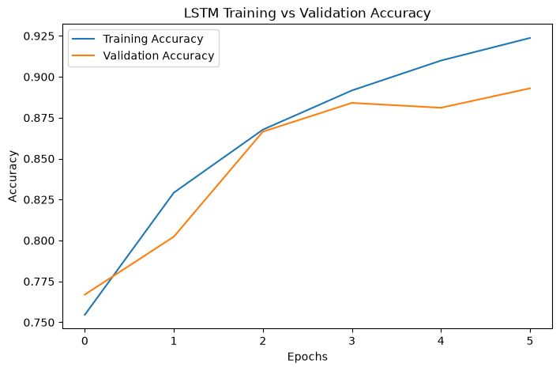
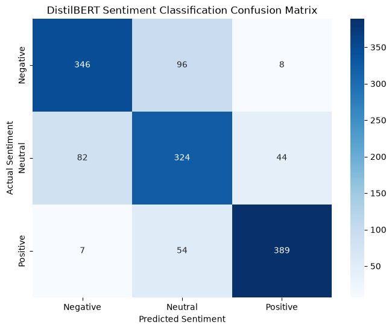
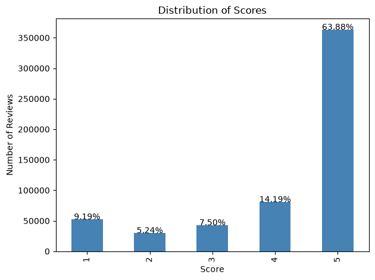
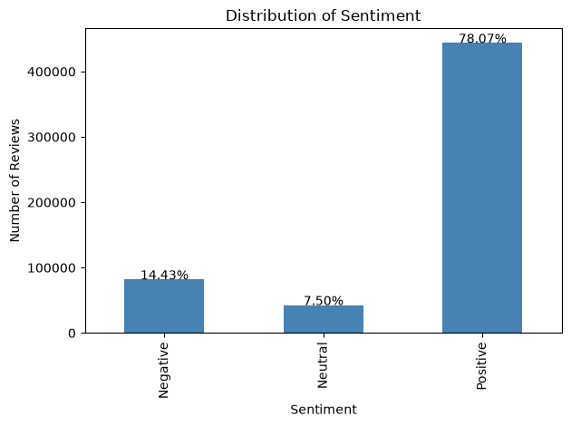
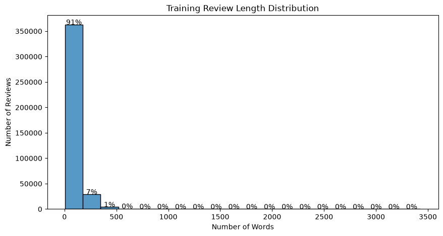
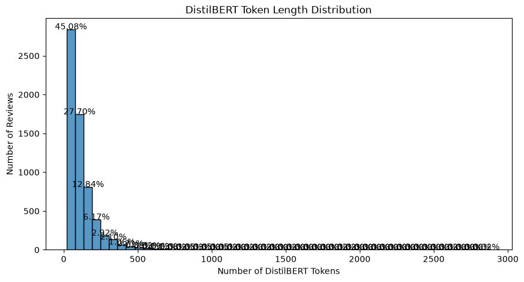

# E-Commerce Review Intelligence System: NLP Sentiment Classification

## Team Details

| Team | Name | Student ID | Email |
|---|---|---|---|
| Team-02 | Shubham Kumar | 2024HB21026 | 2024hb21026@wilp.bits-pilani.ac.in |
| Team-02 | Priyanka Nandakumar Pawar | 2024HB21031 | 2024hb21031@wilp.bits-pilani.ac.in |
| Team-02 | Ravi DN | 2025MN21152 | 2025mn21152@wilp.bits-pilani.ac.in |
| Team-02 | Cindhu K E | 2024HB21027 | 2024hb21027@wilp.bits-pilani.ac.in |

**Project Title:** E-Commerce Review Intelligence System Using NLP and Transformer Models for Customer Sentiment, Topic Extraction, and Business Insights

**Task:** 3-class sentiment classification (Negative / Neutral / Positive) on the Amazon review dataset (`Reviews.csv`).

## 1. Business Problem

E-commerce platforms receive thousands of unstructured customer reviews. Manually reading them does not scale, so dissatisfaction trends and product issues can stay hidden. This project builds a review intelligence system that answers:

- What are customers saying about the product?
- Why are customers satisfied or dissatisfied?
- How can these insights support improvements in product, pricing, marketing, and service?

## 2. Proposed NLP Techniques

- **Text preprocessing and tokenization:** handle missing values, duplicates, and noisy text. The DistilBERT tokenizer prepares text for the Transformer.
- **Sentiment analysis (primary):** classify reviews as Positive, Neutral, or Negative using DistilBERT. TF-IDF with Logistic Regression is the baseline.
- **Topic extraction (secondary):** identify themes such as product quality, battery, camera, screen, price, delivery, product design, customer service, and warranty using BERTopic or a simpler clustering method.
- **Business insights:** combine sentiment and topics, for example Positive for battery and value for money, and Negative for camera quality.

Workflow: Customer Reviews → Preprocessing and Tokenization → TF-IDF + Logistic Regression / DistilBERT Classification → Topic Extraction → Business Insights

## 3. Dataset Description

- Public e-commerce review dataset from Kaggle or another open-source repository, with review text and ratings.
- Ratings are converted to sentiment: 1-2 Negative, 3 Neutral, 4-5 Positive.
- Data used in these experiments: 568,454 reviews (see Section 10 for distribution and splits).
- The data is split into training, validation, and test sets.

## 4. Phase 1 Expected Outcome

A proof-of-concept system that analyzes large volumes of customer reviews and produces structured insights on sentiment and discussion topics. The goal is to help business teams understand satisfaction, find product issues, and support decisions on product improvement, pricing, marketing, and customer service.

## 5. Experiments

### Experiment Descriptions

| # | Experiment | Notebook | Description |
|---|---|---|---|
| 1 | TF-IDF + Logistic Regression | [1_tf_idf_logistic_regression.ipynb](1_tf_idf_logistic_regression.ipynb) | Classical baseline. Text is converted to TF-IDF features (unigrams + bigrams, max 50,000 features), then classified with Logistic Regression using balanced class weights. |
| 2 | Embedding + LSTM | [2_lstm_logistic_regression.ipynb](2_lstm_logistic_regression.ipynb) | Deep learning model. Text is tokenized, passed through a trainable Embedding layer, encoded by an LSTM, and classified with Dense + Softmax. |
| 3 | Fine-tuned DistilBERT | [3_transformer.ipynb](3_transformer.ipynb) | Transformer model. Pretrained DistilBERT is fine-tuned for 3 epochs (learning rate 2e-5, batch size 16, weight decay 0.01) with early stopping. |

## 6. Results

| Experiment | Model | Accuracy (%) | Macro Precision (%) | Macro Recall (%) | Macro F1 (%) |
|---|---|---|---|---|---|
| 1 | TF-IDF + Logistic Regression | 88.72 | 74.21 | 83.34 | 77.43 |
| 2 | Embedding + LSTM | 88.58 | 74.30 | 82.32 | 76.85 |
| 3 | Fine-tuned DistilBERT | 78.44 | 78.70 | 78.44 | 78.55 |

Dummy baseline (majority class): 78.07% accuracy.

### Key Observations

- **Experiment 1 (TF-IDF + LR)** has the highest accuracy and a strong macro F1 for a simple model.
- **Experiment 2 (LSTM)** performs almost the same as Experiment 1 on accuracy but has slightly lower macro F1 and recall.
- **Experiment 3 (DistilBERT)** has the highest macro F1 (78.55%) and macro precision, which makes it the most balanced across classes. Its accuracy is lower, but it was evaluated on a balanced sample of about 1,350 reviews, while Experiments 1 and 2 used the full test set (about 85,000 reviews). The results are therefore not directly comparable, and the 78.07% dummy baseline applies only to the full test set.
- Accuracy alone is misleading here because the dataset is imbalanced. Macro F1 is the better comparison metric.
- Experiment 1 metrics are taken from the printed evaluation output in the notebook, since its result cell has no saved output.

## 7. Implementation Flow

## 8. Phase 2: Mid-Term Progress (Week 5-10)

### Deliverables

| Deliverable | Status | Where |
|---|---|---|
| Working prototype or notebook of the implemented model | Done | Notebooks 1, 2, 3 |
| Intermediate progress report (5-6 pages) | To do | This document is the base for the report |

### Activities

| Activity | Status | Details |
|---|---|---|
| Preprocess text using tokenization, stopword removal, or embeddings | Done | Tokenization in Experiments 2 and 3 (DistilBERT tokenizer). Embeddings in Experiment 2 (trainable Embedding layer). Stopwords are kept, since removing them drops sentiment cues. |
| Build a deep learning model using RNN, LSTM, or Transformer | Done | LSTM in Experiment 2. Transformer (DistilBERT) in Experiment 3. |
| Train and evaluate the model on the organizational dataset | Done | All three experiments evaluated with accuracy and macro metrics (see Results). |
| Perform error analysis and refine the model if needed | Done | Error analysis sections in notebooks 1, 2, and 3. |
| Visualize results (confusion matrix, attention heatmaps) | Partial | Confusion matrices done in all three notebooks. Attention heatmaps not yet created. |
| Word2Vec, GloVe, or BERT embeddings (listed under preprocessing) | Not used | Experiment 2 learns its embeddings during training. Experiment 3 uses DistilBERT's own contextual embeddings. |

### Expected Outcome

- To be added from the handout (the outcome text was not visible in the attachment).

## 9. Graphs and Confusion Matrices

Rows show actual sentiment, columns show predicted sentiment.

**Experiment 1: TF-IDF + Logistic Regression (confusion matrix)**

**Experiment 2: Embedding + LSTM (confusion matrix)**

**Experiment 2: LSTM training vs validation loss**

**Experiment 2: LSTM training vs validation accuracy**

**Experiment 3: Fine-tuned DistilBERT (confusion matrix)**

Note: Experiment 3 uses a balanced sample of about 1,350 reviews, so its matrix is not directly comparable to Experiments 1 and 2 (full test set, about 85,000 reviews).

## 10. Data Distribution

Source: `Reviews.csv` with 568,454 rows and 10 columns. Reviews are scored 1 to 5 and mapped to sentiment as follows: 1-2 Negative, 3 Neutral, 4-5 Positive.

### Full Dataset Distribution

| Score | Sentiment | Count | Share |
|---|---|---|---|
| 1 | Negative | 52,268 | 9.2% |
| 2 | Negative | 29,744 | 5.2% |
| 3 | Neutral | 42,638 | 7.5% |
| 4 | Positive | 80,655 | 14.2% |
| 5 | Positive | 363,122 | 63.9% |

Sentiment totals: Negative 82,012 (14.4%), Neutral 42,638 (7.5%), Positive 443,777 (78.1%). The dataset is heavily imbalanced toward Positive.

Counts are from the notebook outputs. Experiment 1 shows slightly different counts for scores 2 and 3 (29,769 and 42,640); the cause of this difference has not been confirmed. All three notebooks report 0 duplicate rows.

### Train, Validation, and Test Split

| Experiment | Data used | Train | Validation | Test |
|---|---|---|---|---|
| 1 | Full dataset (imbalanced) | 397,898 (70%) | 85,264 (15%) | 85,265 (15%) |
| 2 | Full dataset (imbalanced) | 397,898 (70%) | 85,264 (15%) | 85,265 (15%) |
| 3 | Balanced sample, 3,000 per class | 6,300 (70%) | 1,350 (15%) | 1,350 (15%) |

### Preprocessing Differences

| Step | Experiment 1 (TF-IDF) | Experiment 2 (LSTM) | Experiment 3 (DistilBERT) |
|---|---|---|---|
| Lowercasing | Yes | Yes | No |
| HTML, URL, and symbol removal | Yes | Yes | HTML and whitespace only |
| Text representation | TF-IDF, 50,000 features, unigrams and bigrams | Tokenizer, vocabulary of 30,000, padded to 225 tokens | DistilBERT tokenizer, max 256 tokens |
| Duplicate and null handling | Null summaries dropped, duplicates checked | Null summaries dropped, duplicates checked | Null summaries dropped, duplicates checked |

### Model Settings

| Experiment | Key settings |
|---|---|
| 1 | Logistic Regression, max_iter 1000, balanced class weights |
| 2 | Embedding 128 dimensions, LSTM 64 units, Dropout 0.3, Dense + Softmax, up to 10 epochs, EarlyStopping (patience 2) |
| 3 | distilbert-base-uncased, 3 epochs, learning rate 2e-5, batch size 16, weight decay 0.01, EarlyStopping (patience 2) |

Experiment 2 validation accuracy improved from 76.69% (epoch 1) to 80.23% (epoch 2).

## 11. Key Findings

- **Imbalance drives accuracy.** About 78% of reviews are Positive, so a majority-class model already reaches 78.07% accuracy. Macro F1 is the fairer metric.
- **Neutral is the hardest class.** In the Experiment 1 confusion matrix, Neutral reviews have the highest error rate, mostly being predicted as Negative or Positive.
- **Experiment 3 used a balanced test set.** Its accuracy and F1 should not be compared directly with Experiments 1 and 2.
- **Experiments 1 and 2 perform similarly.** The LSTM does not beat the simpler TF-IDF baseline on this data.

## 12. Limitations and Next Steps

- Topic extraction (BERTopic) and business insight generation from Phase 1 are not yet implemented.
- Experiment 3 was trained and tested on a 9,000-review sample, not the full dataset.
- Experiments 1 and 2 use the full imbalanced dataset, while Experiment 3 uses a balanced one. Use the same test set for a fair comparison.
- Attention heatmaps and a DistilBERT training curve are not yet created.
- Possible next steps: class weighting or resampling for the LSTM and DistilBERT models, and testing DistilBERT on the full dataset.
